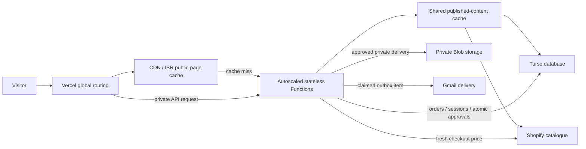

# Traffic distribution and capacity

The production application uses Vercel's managed global routing and autoscaling
Node.js Functions. `vercel.json` explicitly enables Fluid compute and retains
the existing `bom1` region. There is no separately operated NGINX/HAProxy server
or provisioned server fleet. Adding a proxy in front of a single Vercel app
would add a failure point without increasing database or email capacity.



## Implemented controls

- Public company/content and Shopify catalogue queries use Next's shared data
  cache with a 60-second revalidation period. Errors are not converted into a
  successful cached empty catalogue in the loader.
- Home, About, Services, founder profile, sitemap, and project detail pages use
  ISR with a 60-second interval. Project detail paths are generated on demand.
  Search-dependent pages remain dynamic to preserve filters and canonical/noindex
  behavior, while reusing the shared data cache.
- Successful authenticated content create, edit, delete, bootstrap, or company
  updates invalidate the published-content tag and affected page paths.
- `/api/catalog` contains only already-public company and published item data.
  CDN freshness is 60 seconds, with up to 300 seconds of stale-while-revalidate.
  Browser freshness is zero. Do not add customer or authentication fields here.
- Checkout bypasses the browsing cache and reads current Shopify price,
  availability and the ready package record before creating the UPI order.
  The website also supplies its displayed price; a mismatch returns an uncached
  409 response without creating an order, so a stale page cannot silently
  generate a higher payment. Catalogue prices can take up to a cache refresh
  cycle to update on browsing pages.
- Orders, payment screenshots, authentication, approval state, and downloads
  remain dynamic and uncached. Existing shared-database transactions, unique
  payment-reference constraints and conditional outbox claims remain the source
  of truth across backend instances; no sticky sessions or in-memory payment
  decisions are needed.
- The reusable database client keeps a per-instance concurrency bound of 20.
  Local SQLite tests use a five-second busy timeout; production still requires
  remote Turso, and its capacity limits remain independent.
- Form/API duration limits are bounded (30 seconds for checkout/enquiries,
  60 for approval/email handling, 10 for the liveness probe). Private ZIP
  streaming keeps the platform's longer default duration.
- `GET /api/health` is a cheap uncached **liveness** check. It does not test or
  claim database, Shopify, Blob or Gmail readiness. Use protected operational
  checks and actual purchase-flow monitoring for those dependencies.

## Verification

Run `node tests/scaling.mjs` against the isolated temporary database. It uses
provider doubles, not production credentials, files, orders or email recipients.
It checks cache reuse, authenticated cache invalidation, fresh checkout pricing,
unapproved download blocking, and independent-process approval/delivery races.

Run a conservative local read-only load test:

```powershell
$env:LOAD_TEST_URL='http://127.0.0.1:3000'
$env:LOAD_TEST_REQUESTS='200'
$env:LOAD_TEST_CONCURRENCY='10'
node scripts/load-readonly.mjs
```

The runner only requests allowlisted public pages and liveness. It never posts
orders, uploads screenshots or downloads paid ZIPs. Remote tests are disabled
unless `LOAD_TEST_ALLOW_REMOTE=1` is explicitly provided. Do not run a large
test against the live site without an agreed traffic and spend budget.

Observe public page `x-vercel-cache` HIT/STALE responses after warming, origin
error rates, p95/p99 latency, function CPU/memory/concurrency, Turso read/write
latency, Shopify errors and delivery-outbox state. Keep private responses
`no-store`. Roll back through Vercel if cache freshness, payment correctness or
error rates regress.

## Capacity and availability boundaries

This implementation is not a measured promise of one million concurrent users.
Vercel plan/usage limits, Turso write capacity and availability, Shopify limits,
Blob bandwidth and Gmail sending quotas still apply. Manual bank-payment review
also limits order throughput. No infrastructure upgrade or extra region has
been purchased or provisioned.

Multi-region function failover depends on Vercel plan entitlements and must be
configured and exercised together with database failover. A health endpoint and
an autoscaling compute tier do not make a single database or email provider
highly available by themselves.

Before a large launch: define the browsing/checkout/upload mix, desired p95/p99
latency and error budget; size the database and delivery provider; arrange
appropriate Vercel capacity/support and spend limits; then run staged distributed
load, dependency-failure and recovery tests on a representative isolated
environment. Record the actual tested ceiling rather than inferring it from a
small local test.

References: [Fluid compute](https://vercel.com/docs/fluid-compute),
[function limits](https://vercel.com/docs/functions/limitations),
[regions and resiliency](https://vercel.com/docs/regions),
[ISR](https://vercel.com/docs/incremental-static-regeneration),
[Next cache invalidation](https://nextjs.org/docs/app/api-reference/functions/revalidateTag).
